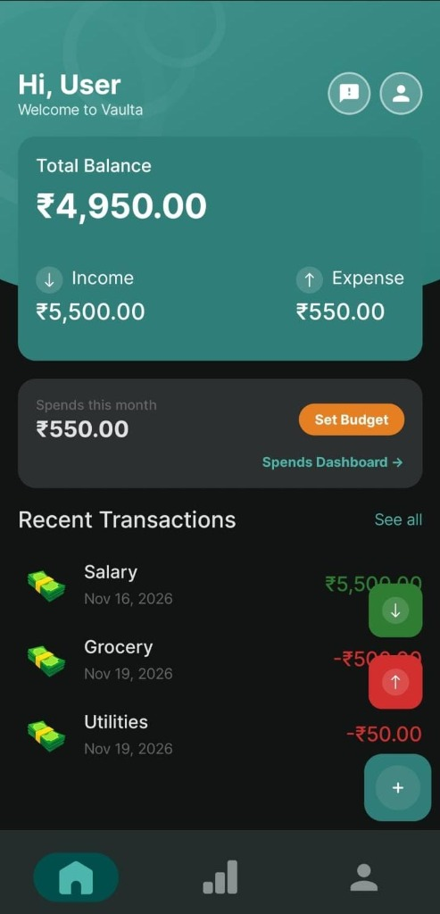
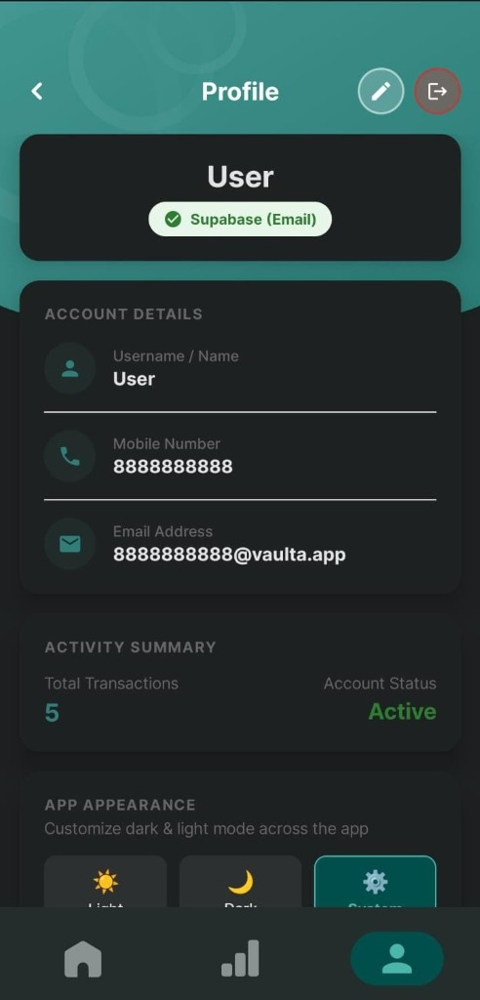

# 💰 Vaulta — Smart Expense Tracker & Personal Finance Manager

<p align="center">
  
</p>

<p align="center">
  <strong>Take absolute control of your personal finances with elegance, precision, and privacy.</strong><br/>
  An intelligent, modern Android personal expense and income tracker built natively with Jetpack Compose, Material 3, Room DB, and Supabase Cloud Auth.
</p>

<p align="center">
  <a href="https://kotlinlang.org/"></a>
  <a href="https://developer.android.com/jetpack/compose"></a>
  <a href="https://supabase.com/"></a>
  <a href="https://developer.android.com/training/dependency-injection/hilt-android"></a>
  <a href="https://developer.android.com/training/data-storage/room"></a>
  <a href="https://developer.android.com/about/versions/14"></a>
  <a href="LICENSE"></a>
</p>

---

## 📖 Table of Contents

- [About Vaulta](#-about-vaulta)
- [Visual App Showcase & Screen Walkthrough](#-visual-app-showcase--screen-walkthrough)
- [Key Features](#-key-features)
  - [1. Modern Authentication & Guest Mode](#1--modern-authentication--guest-mode)
  - [2. Intelligent Real-Time Dashboard](#2--intelligent-real-time-dashboard)
  - [3. Dedicated Income & Expense Logging](#3--dedicated-income--expense-logging)
  - [4. Spends Dashboard & Budget Allocation](#4--spends-dashboard--budget-allocation)
  - [5. Visual Analytics & Gradient Curves](#5--visual-analytics--gradient-curves)
  - [6. Global Multi-Currency Localization](#6--global-multi-currency-localization)
  - [7. App Appearance (Dark & Light Theme)](#7--app-appearance-dark--light-theme)
  - [8. User Profile & Account Management](#8--user-profile--account-management)
- [Architecture & Tech Stack](#-architecture--tech-stack)
- [Supabase Cloud Backend & Database Schema](#-supabase-cloud-backend--database-schema)
- [Project Directory Structure](#-project-directory-structure)
- [Getting Started & Installation](#-getting-started--installation)
- [Contributing](#-contributing)
- [License & Author](#-license--author)

---

## 📱 About Vaulta

**Vaulta** is an all-in-one personal finance manager and smart expense tracker engineered from the ground up for the modern Android ecosystem. Designed to turn complex bookkeeping into an effortless daily habit, Vaulta combines ultra-fast **offline-first local persistence (Room Database)** with **cloud authentication & profile synchronization (Supabase 3.0)**.

Whether you want to track your monthly salary, categorize everyday grocery or utility bills, monitor spending against a strict monthly budget, or visualize your financial velocity through smooth cubic-bezier analytics, Vaulta delivers a fluid, responsive, and privacy-conscious experience.

### Why Vaulta?
- **Speed & Smoothness**: 100% declarative UI in Jetpack Compose and Material 3 with zero XML bloat.
- **Privacy & Flexibility**: Sign up with email or mobile phone, sign in with Google One-Tap, or use the entire app in full **Guest Mode** without signing up.
- **Offline-First Resilience**: All financial transactions remain stored safely on your device in ACID-compliant SQLite via Room.
- **International Ready**: Full support for world currency symbols (₹, $, €, £, ﷼, AED, ¥, etc.) with real-time UI updates.

---

## 📸 Visual App Showcase & Screen Walkthrough

Explore the visual design, typography, and functional layout of Vaulta:

### 1. Onboarding & Authentication
| 🌟 Brand Splash Screen | 🔐 Supabase Sign In | 📝 Registration (Email & Mobile) |
| :---: | :---: | :---: |
|  |  |  |
| *Emerald branding splash with animated logo & security badge.* | *Sign in via Email or Mobile, Google One-Tap, or instantaneous Guest Mode.* | *Tabbed Email & Mobile registration powered by Supabase Auth with RLS.* |

---

### 2. Transaction Management & Cash Flow
| 🏠 Home Dashboard | 🟢 Add Income Flow | 🔴 Add Expense Flow |
| :---: | :---: | :---: |
|  |  |  |
| *Net balance card, monthly income & expense indicators, spend monitor, recent transactions, and multi-action FAB.* | *Dedicated Income entry with custom title pencil button, category dropdown, and date picker.* | *Quick Expense logger with formatted numerical input, category tags, and calendar dialog.* |

---

### 3. Financial Analytics & Budget Tracking
| 📊 Spends Dashboard & Budget | 📉 Expense Statistics Curve | 📈 Income Analytics Curve |
| :---: | :---: | :---: |
|  |  |  |
| *Proportional category progress bar, percentage spend splits, and monthly budget limits.* | *Cubic-bezier expense velocity chart with gradient fill and ranked top expense breakdown.* | *Earnings graph displaying revenue trajectories across custom dates and transactions.* |

---

### 4. Customization, Themes & Profile
| 💱 Currency & Theme Settings | 👤 User Account Details | 📑 Category Allocation View |
| :---: | :---: | :---: |
|  |  |  |
| *Global currency selector with live app-wide update; Light, Dark, and System Theme toggles.* | *Profile card with Supabase auth status, verified email/mobile details, and live transaction counter.* | *Month-by-month category spend distribution and budget tracking insights.* |

> [!TIP]
> All screenshots are available in high resolution inside the [`screenshots/`](screenshots/) directory.

---

## ✨ Key Features

### 1. 🔐 Modern Authentication & Guest Mode
- **Supabase 3.0 Auth Integration**: Native cloud authentication supporting both email and mobile phone credentials.
- **Google One-Tap / Identity Sign-In**: Powered by `androidx.credentials` and Google ID for instantaneous 1-tap sign-ins.
- **Frictionless Guest Access**: Users can skip authentication entirely with **"Continue as Guest"** to maintain 100% anonymous local tracking.
- **Session Auto-Restore**: Encrypted session manager restores your login state seamlessly between application launches.

### 2. 🏠 Intelligent Real-Time Dashboard
- **Live Net Balance Engine**: Automatically recalculates aggregate balance as new earnings and expenditures occur.
- **Monthly Cashflow Overview**: Color-coded Income and Expense cards give an immediate snapshot of current financial health.
- **Monthly Spend Monitor**: Highlights the total spend for the current billing cycle with direct shortcuts to set monthly limits.
- **Recent Transactions Ledger**: Displays verified merchant icons (Salary, Groceries, Utilities, Subscriptions, Rent, etc.) with debit/credit badges.
- **Animated Expandable FAB**: Multi-action floating button with spring animations to trigger either *Add Income* (green) or *Add Expense* (red).

### 3. 💸 Dedicated Income & Expense Logging
- **Dual-Flow Interfaces**: Dedicated composables optimized separately for income streams and expense categories.
- **Custom Title Override**: Tap the ✏️ **"Write Custom Title"** button to enter custom descriptions (e.g., "Freelance Mobile Project", "Organic Farmers Market") while preserving primary category tags.
- **Rich Category Presets**:
  - *Income*: Salary, Freelance, Investments, Bonus, Rental Income, Gifts & Donations, Other.
  - *Expense*: Grocery, Utilities, Food & Dining, Rent, Healthcare, Transport, Shopping, Entertainment, Subscriptions, Education, Debt.
- **Material 3 DatePicker**: Built-in calendar picker allows effortless transaction backdating and historical records tracking.

### 4. 🎯 Spends Dashboard & Budget Allocation
- **Proportional Category Progress Bar**: Visual segmented horizontal bar illustrating exactly which categories consume what percentage of monthly outlays.
- **Ranked Percentage Breakdown**: Displays ranked categories (e.g., Grocery: 90.9%, Utilities: 9.1%) with individual totals.
- **Monthly Budget Goals**: Set a monetary spending ceiling for any month to stay on top of financial milestones.
- **Month Selector Dropdown**: Browse past months and evaluate historical budgeting performance.

### 5. 📈 Visual Analytics & Gradient Curves
- **Cubic-Bezier Charts**: MPAndroidChart integration rendering smooth, anti-aliased curves with elegant gradient fill effects.
- **Tabbed Expense vs. Income Analytics**: Switch seamlessly between expense and income distribution curves.
- **Top Spending Highlights**: Automatically identifies high-ticket spending transactions to help identify unnecessary spending leaks.

### 6. 💱 Global Multi-Currency Localization
- **Worldwide Currency Support**: Choose any world currency:
  - **Dollar (`$`)** — United States, Canada, Australia, Singapore, etc.
  - **Rupee (`₹`, `₨`)** — India, Pakistan, Sri Lanka, Nepal
  - **Pound (`£`)** — United Kingdom
  - **Euro (`€`)** — European Union
  - **Riyal / Dirham (`﷼`, `AED`, `SAR`)** — UAE, Saudi Arabia, Qatar
  - **Dinar (`KD`, `BD`, `JD`)** — Kuwait, Bahrain, Jordan
  - **Yen / Yuan (`¥`)** — Japan, China
  - **Franc (`CHF`)**, and dozens more.
- **Instant Reactive Propagation**: Changing currency in Settings propagates immediately across the Dashboard, cards, recent lists, analytics axes, and input forms.

### 7. 🌗 App Appearance (Dark & Light Theme)
- Fully customized dark mode, light mode, and system-adaptive modes.
- Emerald green accents (`#00796B`) paired with high-contrast surfaces (`#121212`, `#1E1E1E`) for optimal OLED battery efficiency and eye comfort.

### 8. 👤 User Profile & Account Management
- View authenticated account status, linked email, phone number, and account creation dates.
- Live **Transaction Count Counter**: Displays total transactions logged in local storage.
- Edit Profile Information dialog to update personal display details.
- Secure session sign-out with instant local state reset.

---

## 🏗️ Architecture & Tech Stack

Vaulta is built according to Google's official recommended Android App Architecture guidelines, implementing MVVM (Model-View-ViewModel) paired with Unidirectional Data Flow (UDF) and Dependency Injection:

```
┌────────────────────────────────────────────────────────┐
│                   UI Layer (View)                      │
│        Jetpack Compose (Material 3 Components)         │
│ HomeScreen | AddExpense | SpendsDashboard | StatsScreen│
└──────────────────────────▲─────────────────────────────┘
                           │ Observes State (StateFlow)
                           │ Emits UI Events
┌──────────────────────────┴─────────────────────────────┐
│                   ViewModel Layer                      │
│   HomeViewModel | BudgetViewModel | ProfileViewModel   │
│              (Lifecycle-Aware StateHolder)             │
└──────────────────────────▲─────────────────────────────┘
                           │ Reactive Streams (Flow)
                           │ Coroutines Dispatchers
┌──────────────────────────┴─────────────────────────────┐
│                  Repository Layer                      │
│        ExpenseRepository | SupabaseAuthRepository      │
└──────────────────────────▲─────────────────────────────┘
              ┌────────────┴────────────┐
              ▼                         ▼
┌──────────────────────────┐  ┌──────────────────────────┐
│      Local Storage       │  │      Cloud Backend       │
│      Room Database       │  │      Supabase 3.0        │
│   (ACID SQLite SQLite)   │  │   (Auth + RLS Database)  │
└──────────────────────────┘  └──────────────────────────┘
```

### 🛠️ Technology Breakdown

| Layer | Component | Version | Description |
|---|---|---|---|
| **Language** | [Kotlin](https://kotlinlang.org/) | `1.9.24` | Modern, safe, and expressive language for native Android |
| **UI Toolkit** | [Jetpack Compose BOM](https://developer.android.com/jetpack/compose) | `2024.06.00` | Declarative reactive UI toolkit |
| **Design System** | [Material 3](https://m3.material.io/) | Latest | Google's latest Material Design specifications |
| **Backend & Auth** | [Supabase BOM](https://supabase.com/) | `3.0.0` | `auth-kt`, `postgrest-kt` for scalable cloud authentication |
| **Google Sign-In** | [AndroidX Credentials](https://developer.android.com/training/sign-in/credential-manager) | `1.3.0` | Modern Credential Manager with Google ID (`1.1.1`) |
| **HTTP Engine** | [Ktor Client OkHttp](https://ktor.io/) | `3.0.0` | High-performance asynchronous HTTP networking engine |
| **Serialization** | [Kotlinx Serialization](https://github.com/Kotlin/kotlinx.serialization) | `1.6.3` | Type-safe JSON parsing and payload deserialization |
| **Dependency Injection** | [Dagger Hilt](https://dagger.dev/hilt/) | `2.51` | Standardized modular dependency injection across the app |
| **Local Persistence** | [Room Database](https://developer.android.com/training/data-storage/room) | `2.6.1` | SQLite object mapping abstraction layer with Coroutines Flow |
| **Concurrency** | [Kotlin Coroutines & Flow](https://kotlinlang.org/docs/coroutines-overview.html) | `1.8+` | Structured concurrency and asynchronous stream processing |
| **Navigation** | [Navigation Compose](https://developer.android.com/jetpack/compose/navigation) | `2.7.7` | Type-safe screen navigation graphs |
| **Charts & Graphs** | [MPAndroidChart](https://github.com/PhilJay/MPAndroidChart) | `v3.1.0` | Cubic bezier line graphs and financial visualizer |
| **Layouts** | [ConstraintLayout Compose](https://developer.android.com/develop/ui/compose/layouts/constraintlayout) | `1.0.1` | Precise positional constraint modeling |

---

## ☁️ Supabase Cloud Backend & Database Schema

Vaulta comes with a complete, production-ready SQL migration script (`supabase_schema.sql`) for PostgreSQL on Supabase:

- **Row Level Security (RLS)**: Enforces strict data isolation so users can only ever access and modify their own records.
- **PostgreSQL Automation Trigger (`handle_new_user`)**: Listens to Supabase `auth.users` creation events and automatically populates the `public.profiles` table with usernames, emails, phone numbers, and authentication providers.

To run the schema:
1. Open your [Supabase Dashboard](https://supabase.com/).
2. Navigate to **SQL Editor** -> **New Query**.
3. Paste the contents of [`supabase_schema.sql`](supabase_schema.sql) and click **Run**.

---

## 📂 Project Directory Structure

```text
Vaulta/
├── app/
│   ├── src/
│   │   ├── main/
│   │   │   ├── java/com/waleed/vaulta/android/
│   │   │   │   ├── base/                    # Base ViewModels & UI Navigation events
│   │   │   │   ├── data/                    # Data sources, database, and repositories
│   │   │   │   │   ├── auth/                # Supabase auth client & Google Credential manager
│   │   │   │   │   ├── budget/              # Budget preferences & monthly limits
│   │   │   │   │   ├── dao/                 # Room DAOs (ExpenseDao with Flow queries)
│   │   │   │   │   ├── model/               # ExpenseEntity, Currency, UserProfile, Budget
│   │   │   │   │   ├── repository/          # ExpenseRepository, AuthRepository
│   │   │   │   │   ├── session/             # Encrypted session persistence
│   │   │   │   │   ├── CurrencyManager.kt   # Global currency reactive state holder
│   │   │   │   │   └── ExpenseDatabase.kt   # Room Database class & migrations
│   │   │   │   ├── di/                      # Dagger Hilt DatabaseModule & RepositoryModule
│   │   │   │   ├── feature/                 # Feature-driven Compose screens
│   │   │   │   │   ├── add_expense/         # Add Expense & Income with custom title
│   │   │   │   │   ├── auth/                # LoginScreen, RegisterScreen, AuthViewModel
│   │   │   │   │   ├── budget/              # SpendsDashboardScreen & category bars
│   │   │   │   │   ├── home/                # HomeScreen, balance cards, recent feed
│   │   │   │   │   ├── profile/             # ProfileScreen, currency dialog, theme toggle
│   │   │   │   │   ├── splash/              # Animated brand SplashScreen
│   │   │   │   │   ├── stats/               # MPAndroidChart bezier curve analytics
│   │   │   │   │   └── transactionlist/     # Full searchable ledger with filters
│   │   │   │   ├── ui/theme/                # Colors, Typography, Shapes, Material 3 Theme
│   │   │   │   ├── utils/                   # Currency formatters, date utilities, toast helpers
│   │   │   │   ├── widget/                  # ExpenseTextView & custom reusable widgets
│   │   │   │   ├── MainActivity.kt          # Single-Activity entry point
│   │   │   │   ├── NavHostScreen.kt         # Navigation graph & animated bottom app bar
│   │   │   │   └── Vaulta.kt                # Application class (@HiltAndroidApp)
│   │   │   └── res/                         # Vector drawables, mipmaps, string resources
│   │   └── test/                            # Unit and instrumentation tests
│   ├── build.gradle.kts                     # App module build script & buildConfig fields
│   └── proguard-rules.pro                   # ProGuard / R8 rules
├── gradle/
│   └── libs.versions.toml                   # Central dependency version catalog
├── screenshots/                             # 12 high-resolution application screenshots
├── .gitignore                               # Standard git ignore definitions
├── build.gradle.kts                         # Root project build configuration
├── local.properties.example                 # Template for API credentials and SDK path
├── PRIVACY_POLICY.md                        # Official Privacy Policy document
├── settings.gradle.kts                      # Gradle settings & plugin repository configurations
├── supabase_schema.sql                      # Supabase PostgreSQL database schema & triggers
└── README.md                                # Project documentation
```

---

## 🚀 Getting Started & Installation

### Prerequisites

- **Android Studio**: Android Studio Jellyfish / Iguana (2023.2.1+) or newer.
- **JDK**: Java 17 or higher.
- **Android SDK**: API Level 34 / 36 (Android 14+).
- **Minimum OS Supported**: Android 7.0 (API Level 24).

### Step-by-Step Setup

1. **Clone the repository:**
   ```bash
   git clone https://github.com/WinBlader/Vaulta-Smart-Expense-Tracker.git
   cd Vaulta-Smart-Expense-Tracker
   ```

2. **Configure Local Properties:**
   Copy `local.properties.example` to `local.properties`:
   ```bash
   cp local.properties.example local.properties
   ```
   Add your Android SDK path and optional Supabase / Google Client IDs:
   ```properties
   sdk.dir=/path/to/your/android/sdk
   SUPABASE_URL=https://your-project-ref.supabase.co
   SUPABASE_ANON_KEY=your-supabase-anon-key
   GOOGLE_WEB_CLIENT_ID=your-google-web-client-id.apps.googleusercontent.com
   ```
   *(Note: If left blank or default, Vaulta runs in offline Guest Mode with all features enabled).*

3. **Open in Android Studio:**
   - Launch Android Studio and choose **Open**.
   - Select the `Vaulta-Smart-Expense-Tracker` folder.
   - Wait for the Gradle sync to finish.

4. **Build the Debug APK:**
   ```bash
   ./gradlew assembleDebug
   ```

5. **Deploy to Device or Emulator:**
   - Connect an Android device with USB Debugging enabled, or launch an Android Virtual Device (AVD).
   - Click the green **Run ▶** button in Android Studio.

---

## 🤝 Contributing

Contributions make the open-source community thrive! Any contributions you make are greatly appreciated:

1. **Fork** the Project.
2. **Create your Feature Branch**:
   ```bash
   git checkout -b feature/NewAwesomeFeature
   ```
3. **Commit your Changes**:
   ```bash
   git commit -m "feat: Add NewAwesomeFeature"
   ```
4. **Push to the Branch**:
   ```bash
   git push origin feature/NewAwesomeFeature
   ```
5. **Open a Pull Request**.

---

## 📜 License

Distributed under the **MIT License**. See [`LICENSE`](LICENSE) for complete details.

---

## 👨‍💻 Author & Contact

**Waleed Wani**
- **GitHub**: [@WinBlader](https://github.com/WinBlader)
- **Repository**: [WinBlader/Vaulta-Smart-Expense-Tracker](https://github.com/WinBlader/Vaulta-Smart-Expense-Tracker)
- **Email**: `waleedwani06072005@gmail.com`
- **Website**: [winblader.org](https://winblader.org)

<p align="center">
  If you find Vaulta useful or inspiring, please give this repository a ⭐️!
</p>
