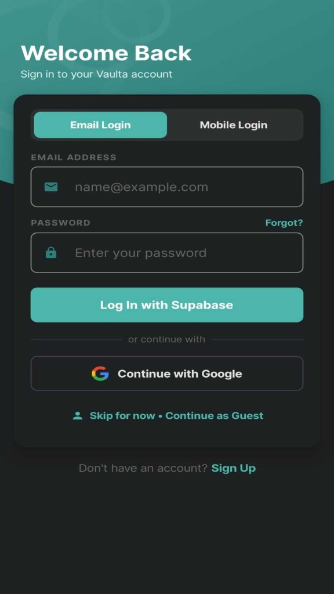
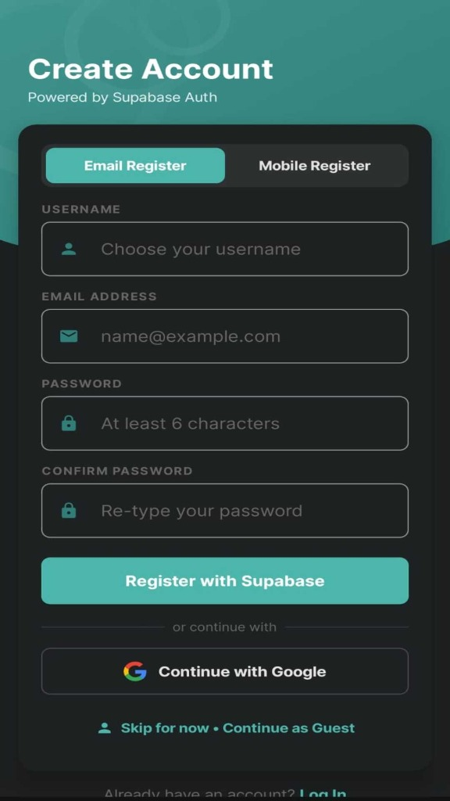
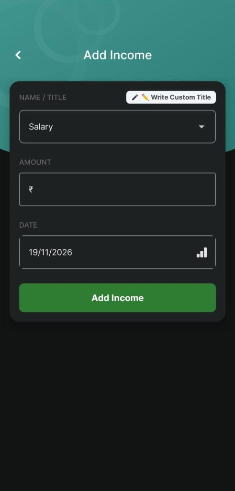
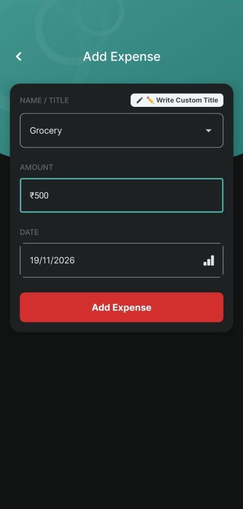
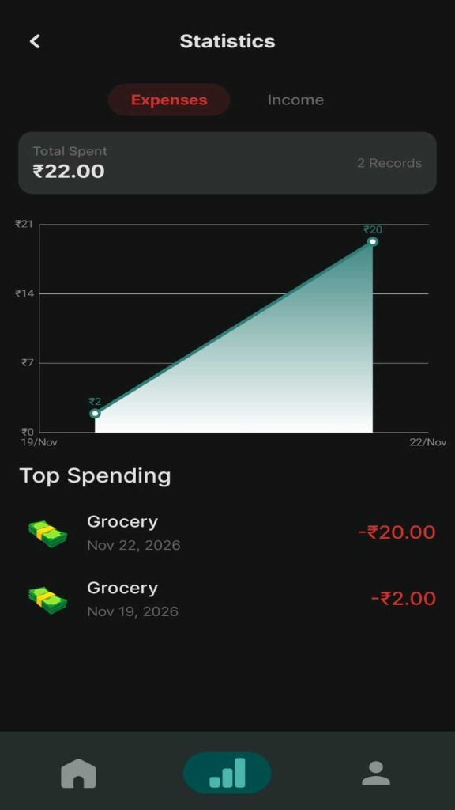
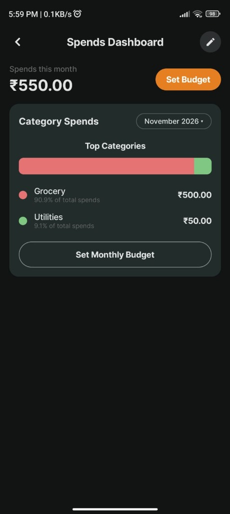

# 💰 Vaulta — Smart Expense Tracker & Personal Finance Manager

<p align="center">
  
</p>

<p align="center">
  <strong>Take absolute control of your personal finances with elegance, precision, and privacy.</strong><br/>
  An intelligent, modern Android personal expense and income tracker built natively with Jetpack Compose, Material 3, Room DB, and Supabase Cloud Auth.
</p>

<p align="center">
  <a href="https://kotlinlang.org/"></a>
  <a href="https://developer.android.com/jetpack/compose"></a>
  <a href="https://supabase.com/"></a>
  <a href="https://developer.android.com/training/dependency-injection/hilt-android"></a>
  <a href="https://developer.android.com/training/data-storage/room"></a>
  <a href="https://developer.android.com/about/versions/14"></a>
  <a href="LICENSE"></a>
</p>

---

## 📖 Table of Contents

- [About Vaulta](#-about-vaulta)
- [What's New in v1.1.0](#-whats-new-in-v110)
- [Visual App Showcase & Screen Walkthrough](#-visual-app-showcase--screen-walkthrough)
- [Key Features](#-key-features)
  - [1. International Authentication & Guest Mode](#1--international-authentication--guest-mode)
  - [2. Multi-Account Privacy & RoomDB Isolation](#2--multi-account-privacy--roomdb-isolation)
  - [3. Advanced Transaction Search, Filters & Date Range](#3--advanced-transaction-search-filters--date-range)
  - [4. Direct PDF Download & Receipt Sharing](#4--direct-pdf-download--receipt-sharing)
  - [5. Custom Vaulta-Branded Floating Snackbars](#5--custom-vaulta-branded-floating-snackbars)
  - [6. Real-Time Dashboard & Quick Loggers](#6--real-time-dashboard--quick-loggers)
  - [7. Spends Dashboard & Budget Limits](#7--spends-dashboard--budget-limits)
  - [8. Visual Analytics & Gradient Curves](#8--visual-analytics--gradient-curves)
  - [9. Multi-Currency & Appearance Themes](#9--multi-currency--appearance-themes)
- [Architecture & Tech Stack](#-architecture--tech-stack)
- [Supabase Cloud Backend & Database Schema](#-supabase-cloud-backend--database-schema)
- [Project Directory Structure](#-project-directory-structure)
- [Getting Started & Installation](#-getting-started--installation)
- [Contributing](#-contributing)
- [License & Author](#-license--author)

---

## 📱 About Vaulta

**Vaulta** is an all-in-one personal finance manager and smart expense tracker engineered from the ground up for the modern Android ecosystem. Designed to turn complex bookkeeping into an effortless daily habit, Vaulta combines ultra-fast **offline-first local persistence (Room Database v3)** with **cloud authentication & profile synchronization (Supabase 3.0)**.

Whether tracking monthly salaries, categorizing grocery and utility bills, monitoring spending against strict monthly budgets, or exporting itemized statements directly to PDF, Vaulta delivers a fluid, responsive, and privacy-conscious experience.

---

## 🚀 What's New in v1.1.0

- 📥 **Direct PDF Download**: Export single transaction receipts or filtered statements directly into public `Downloads/Vaulta/` using Scoped Storage (`MediaStore.Downloads` on Android 10+), without opening external share sheets.
- 🔒 **Zero Data-Leak Multi-Account Isolation**: RoomDB `expense_table` is strictly partitioned by `userId`. Logging out purges cached local records and resets per-user budgets, guaranteeing Account B never sees Account A's transactions.
- 🎨 **Vaulta-Branded In-App Snackbars**: Replaced Android 12+ system toasts with smooth Compose-animated floating pills displaying Vaulta's official app launcher icon (`@mipmap/final_icon`) and interactive **"OPEN"** actions.
- 🌍 **Side-by-Side Editable Country Code**: Supports all international country calling codes (`+1`, `+44`, `+971`, etc.) alongside `+91` on Mobile Register and Mobile Login with E.164 normalization.
- 🔍 **Advanced Transaction Search & Filtering**: Instant keyword search, Income/Expense chips, category filters, Material 3 `DateRangePicker` for custom date ranges, and a dynamic KPI balance strip.
- 🛡️ **Password Reset Hints**: Helper notes alerting users to check Spam/Promotions folders during password resets.

---

## 📸 Visual App Showcase & Screen Walkthrough

Explore the visual design, typography, and functional layout of Vaulta:

### 1. Onboarding & Authentication
| 🌟 Brand Splash Screen | 🔐 Supabase Sign In | 📝 Registration (Email & Mobile) |
| :---: | :---: | :---: |
|  |  |  |
| *Emerald branding splash with animated logo & security badge.* | *Sign in via Email or Mobile, Google One-Tap, or instantaneous Guest Mode.* | *Tabbed Email & Mobile registration with editable country code & Supabase Auth.* |

---

### 2. Transaction Management & Cash Flow
| 🏠 Home Dashboard | 🟢 Add Income Flow | 🔴 Add Expense Flow |
| :---: | :---: | :---: |
|  |  |  |
| *Net balance card, monthly cashflow cards, spend monitor, recent transactions, and multi-action FAB.* | *Dedicated Income entry with custom title pencil button, category dropdown, and date picker.* | *Quick Expense logger with formatted numerical input, category tags, and calendar dialog.* |

---

### 3. Financial Analytics & Budget Tracking
| 📊 Spends Dashboard & Budget | 📉 Expense Statistics Curve | 📈 Income Analytics Curve |
| :---: | :---: | :---: |
|  |  |  |
| *Proportional category progress bar, percentage spend splits, and monthly budget limits.* | *Cubic-bezier expense velocity chart with gradient fill and ranked top expense breakdown.* | *Earnings graph displaying revenue trajectories across custom dates and transactions.* |

---

### 4. Customization, Themes & Profile
| 💱 Currency & Theme Settings | 👤 User Account Details | 📑 Category Allocation View |
| :---: | :---: | :---: |
|  |  |  |
| *Global currency selector with live app-wide update; Light, Dark, and System Theme toggles.* | *Profile card with Supabase auth status, verified email/mobile details, and live transaction counter.* | *Month-by-month category spend distribution and budget tracking insights.* |

> [!TIP]
> All screenshots are available in high resolution inside the [`screenshots/`](screenshots/) directory.

---

## ✨ Key Features

### 1. 🔐 International Authentication & Guest Mode
- **Editable Country Calling Code**: Compact `OutlinedTextField` (`84.dp`) for international country codes (`+1`, `+44`, `+91`, `+971`), paired with full E.164 phone normalization.
- **Supabase 3.0 Auth Integration**: Cloud authentication supporting email and mobile credentials with Row Level Security (RLS).
- **Google One-Tap / Identity Sign-In**: Powered by `androidx.credentials` and Google ID for instantaneous 1-tap sign-ins.
- **Frictionless Guest Access**: Use the entire app anonymously without signing up.

### 2. 🛡️ Multi-Account Privacy & RoomDB Isolation
- **User-Partitioned SQLite Table**: `ExpenseEntity` stores `userId`, guaranteeing that queries (`WHERE userId = :userId`) only access rows belonging to the active session.
- **Automated Sign-Out Purge**: On logout or account switch, local transaction caches are wiped and per-user monthly budgets reset.
- **Room Migration v2 ➔ v3**: Automatic non-destructive schema migration (`MIGRATION_2_3`) with safe fallback handling.

### 3. 🔍 Advanced Transaction Search, Filters & Date Range
- **Instant Search Bar**: Real-time filtering matching transaction notes, category tags, or numeric amounts.
- **Filter Chips**: Quickly toggle between **All**, **Income**, and **Expense**.
- **Material 3 DateRangePicker**: Select custom date intervals (e.g., custom tax year, travel trip) alongside preset filters (*Today*, *This Week*, *This Month*, *Last Month*).
- **Reactive KPI Summary Strip**: Dynamically computes filtered Income, Expense, and Net Balance with a one-tap **Reset Filters** button.

### 4. 📄 Direct PDF Download & Receipt Sharing
- **Direct Save to Downloads**: Save transaction receipts and statement PDFs directly to `Downloads/Vaulta/` via Scoped Storage without permission prompts on Android 10+.
- **Branded Receipt Generation**: Render high-res A4 documents and PNG image cards with Vaulta headers, verified status badges, reference IDs, and user currency symbols.
- **Instant File Viewer Intent**: Download notifications feature an **"OPEN"** button to view PDFs directly in your device's preferred PDF viewer.

### 5. 🔔 Custom Vaulta-Branded Floating Snackbars
- **No Android System Robot Icon**: Replaced `Toast.makeText` with `VaultaSnackbarHost`.
- **Dark-Teal Floating Pill**: Animated card (`#102220`) featuring the official Vaulta launcher icon (`@mipmap/final_icon`), smooth slide-in animations, auto-dismiss, and action button support.

### 6. 🏠 Real-Time Dashboard & Quick Loggers
- **Live Net Balance Engine**: Automatically recalculates total balance as earnings and expenses are logged.
- **Dedicated Income & Expense Composable**: Optimized forms with custom title overrides (✏️ pencil button) and calendar picker.
- **Animated Expandable FAB**: Spring animations trigger *Add Income* (green) or *Add Expense* (red).

### 7. 🎯 Spends Dashboard & Budget Limits
- **Category Progress Bar**: Segmented horizontal progress bar showing category spend percentages.
- **Monthly Spending Ceiling**: Set monetary spending limits with automatic notification alerts when approaching 80% or exceeding 100%.

### 8. 📈 Visual Analytics & Gradient Curves
- **MPAndroidChart Cubic-Bezier Curves**: Smooth anti-aliased velocity graphs with gradient fill effects.
- **Top Spending Highlights**: Identifies top transactions to pinpoint spending leaks.

### 9. 💱 Multi-Currency & Appearance Themes
- **Worldwide Currencies**: Dollar (`$`), Rupee (`₹`), Pound (`£`), Euro (`€`), Dirham (`AED`), Yen (`¥`), Dinar (`KD`), Franc (`CHF`), and dozens more with reactive app-wide updates.
- **Dark & Light Themes**: Dark mode, light mode, and system-adaptive modes with Emerald Green accents (`#00796B`) and high-contrast OLED surfaces (`#121212`).

---

## 🏗️ Architecture & Tech Stack

Vaulta follows Google's recommended Android Architecture Guidelines implementing MVVM (Model-View-ViewModel) paired with Unidirectional Data Flow (UDF) and Dependency Injection:

```
┌────────────────────────────────────────────────────────┐
│                   UI Layer (View)                      │
│        Jetpack Compose (Material 3 Components)         │
│ HomeScreen | AddExpense | SpendsDashboard | StatsScreen│
│ TransactionListScreen | VaultaSnackbarHost             │
└──────────────────────────▲─────────────────────────────┘
                           │ Observes State (StateFlow)
                           │ Emits UI Events
┌──────────────────────────┴─────────────────────────────┐
│                   ViewModel Layer                      │
│   HomeViewModel | BudgetViewModel | ProfileViewModel   │
│   TransactionListViewModel | AuthViewModel             │
└──────────────────────────▲─────────────────────────────┘
                           │ Reactive Streams (Flow)
                           │ Coroutines Dispatchers
┌──────────────────────────┴─────────────────────────────┐
│                  Repository Layer                      │
│        ExpenseRepository | SupabaseAuthRepository      │
│        BudgetRepository  | UserSessionManager          │
└──────────────────────────▲─────────────────────────────┘
              ┌────────────┴────────────┐
              ▼                         ▼
┌──────────────────────────┐  ┌──────────────────────────┐
│      Local Storage       │  │      Cloud Backend       │
│      Room Database       │  │      Supabase 3.0        │
│    (v3 User-Scoped)      │  │   (Auth + RLS Database)  │
└──────────────────────────┘  └──────────────────────────┘
```

### 🛠️ Technology Breakdown

| Layer | Component | Version | Description |
|---|---|---|---|
| **Language** | [Kotlin](https://kotlinlang.org/) | `1.9.24` | Modern, safe, and expressive language for native Android |
| **UI Toolkit** | [Jetpack Compose BOM](https://developer.android.com/jetpack/compose) | `2024.06.00` | Declarative reactive UI toolkit |
| **Design System** | [Material 3](https://m3.material.io/) | Latest | Google's Material Design specifications |
| **Backend & Auth** | [Supabase BOM](https://supabase.com/) | `3.0.0` | `auth-kt`, `postgrest-kt` for cloud authentication |
| **Google Sign-In** | [AndroidX Credentials](https://developer.android.com/training/sign-in/credential-manager) | `1.3.0` | Credential Manager with Google ID (`1.1.1`) |
| **HTTP Engine** | [Ktor Client OkHttp](https://ktor.io/) | `3.0.0` | Asynchronous HTTP networking engine |
| **Dependency Injection** | [Dagger Hilt](https://dagger.dev/hilt/) | `2.51` | Modular dependency injection across the app |
| **Local Persistence** | [Room Database](https://developer.android.com/training/data-storage/room) | `2.6.1` (DB v3) | User-partitioned SQLite with Coroutines Flow |
| **PDF Generation** | Android `PdfDocument` | Native | Vector A4 receipt & financial statement generator |
| **File Storage** | `MediaStore.Downloads` | Native | Scoped storage direct download to `Downloads/Vaulta/` |
| **Charts & Graphs** | [MPAndroidChart](https://github.com/PhilJay/MPAndroidChart) | `v3.1.0` | Cubic bezier line graphs and financial visualizer |

---

## ☁️ Supabase Cloud Backend & Database Schema

Vaulta includes a complete PostgreSQL migration script ([`supabase_schema.sql`](supabase_schema.sql)) for Supabase:

- **Row Level Security (RLS)**: Enforces strict data isolation so users only access their own records.
- **PostgreSQL Automation Trigger (`handle_new_user`)**: Listens to Supabase `auth.users` creation events and populates `public.profiles` with usernames, emails, and phone numbers.

---

## 📂 Project Directory Structure

```text
Vaulta/
├── app/
│   ├── src/
│   │   ├── main/
│   │   │   ├── java/com/waleed/vaulta/android/
│   │   │   │   ├── base/                    # Base ViewModels & UI Navigation events
│   │   │   │   ├── data/                    # Data sources, database, and repositories
│   │   │   │   │   ├── auth/                # Supabase auth client & phone normalization
│   │   │   │   │   ├── budget/              # Budget preferences & notification helpers
│   │   │   │   │   ├── dao/                 # ExpenseDao with user-partitioned Flow queries
│   │   │   │   │   ├── model/               # ExpenseEntity (userId scoped), Currency, UserProfile
│   │   │   │   │   ├── repository/          # ExpenseRepository, AuthRepository, BudgetRepository
│   │   │   │   │   ├── session/             # UserSessionManager & account registry
│   │   │   │   │   ├── CurrencyManager.kt   # Global currency reactive state holder
│   │   │   │   │   └── ExpenseDatabase.kt   # Room Database class (v3) & migrations
│   │   │   │   ├── di/                      # Dagger Hilt DatabaseModule & RepositoryModule
│   │   │   │   ├── feature/                 # Feature-driven Compose screens
│   │   │   │   │   ├── add_expense/         # Add Expense & Income with custom title
│   │   │   │   │   ├── auth/                # LoginScreen, RegisterScreen, PasswordResetDialog
│   │   │   │   │   ├── budget/              # SpendsDashboardScreen & category bars
│   │   │   │   │   ├── home/                # HomeScreen, balance cards, recent feed
│   │   │   │   │   ├── profile/             # ProfileScreen, currency dialog, theme toggle
│   │   │   │   │   ├── splash/              # Animated brand SplashScreen
│   │   │   │   │   ├── stats/               # MPAndroidChart bezier curve analytics
│   │   │   │   │   └── transactionlist/     # Searchable ledger, filters & receipt dialogs
│   │   │   │   ├── ui/theme/                # Colors, Typography, Shapes, Material 3 Theme
│   │   │   │   ├── utils/                   # ReceiptExportManager (PDF/PNG), VaultaToast
│   │   │   │   ├── widget/                  # VaultaSnackbarHost & custom UI widgets
│   │   │   │   ├── MainActivity.kt          # Single-Activity entry point
│   │   │   │   ├── NavHostScreen.kt         # Navigation graph & animated bottom app bar
│   │   │   │   └── Vaulta.kt                # Application class (@HiltAndroidApp)
│   │   │   └── res/                         # Vector drawables, mipmaps, string resources
│   │   └── test/                            # Unit and instrumentation tests
│   ├── build.gradle.kts                     # App module build script (v1.1.0, versionCode 2)
│   └── proguard-rules.pro                   # ProGuard / R8 rules
├── screenshots/                             # 12 high-resolution application screenshots
├── PRIVACY_POLICY.md                        # Official Privacy Policy document
├── supabase_schema.sql                      # Supabase PostgreSQL database schema & triggers
└── README.md                                # Project documentation
```

---

## 🚀 Getting Started & Installation

### Prerequisites

- **Android Studio**: Android Studio Jellyfish / Iguana (2023.2.1+) or newer.
- **JDK**: Java 17 or higher.
- **Android SDK**: API Level 34 / 36 (Android 14+).
- **Minimum OS Supported**: Android 7.0 (API Level 24).

### Step-by-Step Setup

1. **Clone the repository:**
   ```bash
   git clone https://github.com/WinBlader/Vaulta-Smart-Expense-Tracker.git
   cd Vaulta-Smart-Expense-Tracker
   ```

2. **Configure Local Properties:**
   Copy `local.properties.example` to `local.properties`:
   ```bash
   cp local.properties.example local.properties
   ```
   Add your Android SDK path and optional Supabase / Google Client IDs:
   ```properties
   sdk.dir=/path/to/your/android/sdk
   SUPABASE_URL=https://your-project-ref.supabase.co
   SUPABASE_ANON_KEY=your-supabase-anon-key
   GOOGLE_WEB_CLIENT_ID=your-google-web-client-id.apps.googleusercontent.com
   ```
   *(Note: If left blank or default, Vaulta runs in offline Guest Mode with all features enabled).*

3. **Build the Debug APK:**
   ```bash
   ./gradlew assembleDebug
   ```

4. **Deploy to Device or Emulator:**
   - Connect an Android device with USB Debugging enabled, or launch an AVD.
   - Click the green **Run ▶** button in Android Studio.

---

## 🤝 Contributing

Contributions make the open-source community thrive! Any contributions you make are greatly appreciated:

1. **Fork** the Project.
2. **Create your Feature Branch**:
   ```bash
   git checkout -b feature/NewFeature
   ```
3. **Commit your Changes**:
   ```bash
   git commit -m "feat: Add NewFeature"
   ```
4. **Push to the Branch**:
   ```bash
   git push origin feature/NewFeature
   ```
5. **Open a Pull Request**.

---

## 📜 License

Distributed under the **MIT License**. See [`LICENSE`](LICENSE) for complete details.

---

## 👨‍💻 Author & Contact

**Waleed Wani**
- **GitHub**: [@WinBlader](https://github.com/WinBlader)
- **Repository**: [WinBlader/Vaulta-Smart-Expense-Tracker](https://github.com/WinBlader/Vaulta-Smart-Expense-Tracker)
- **Email**: `waleedwani06072005@gmail.com`
- **Website**: [winblader.org](https://winblader.org)

<p align="center">
  If you find Vaulta useful or inspiring, please give this repository a ⭐️!
</p>
