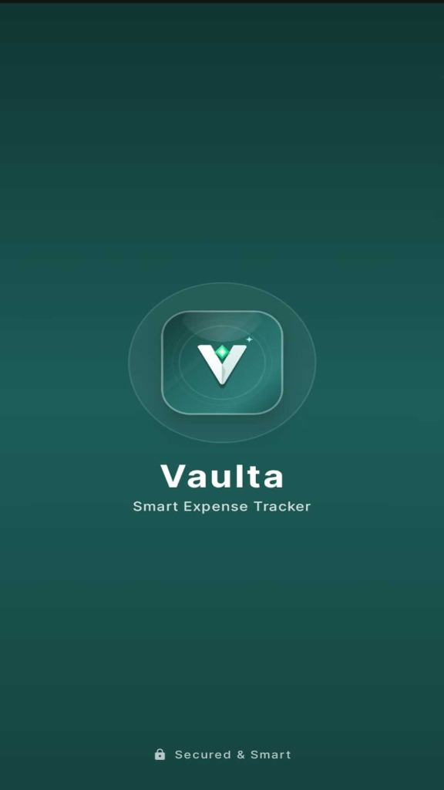
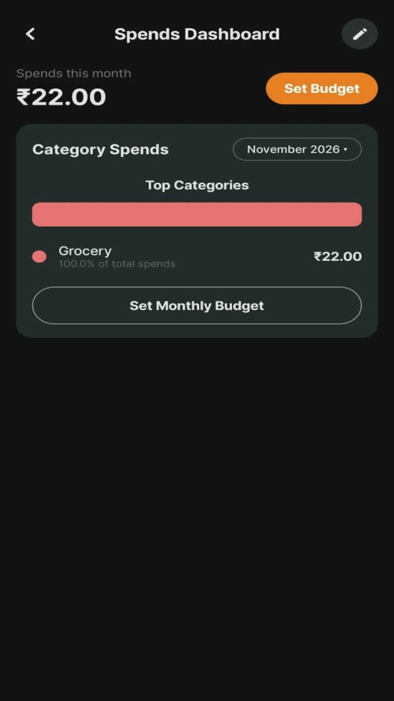
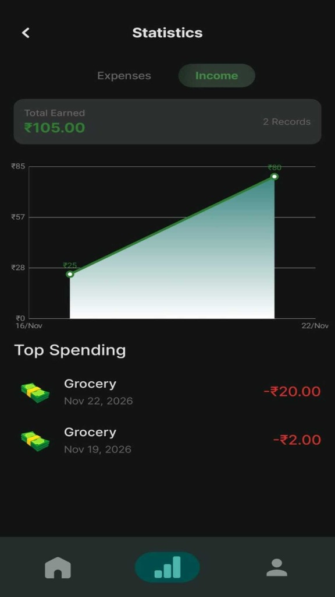
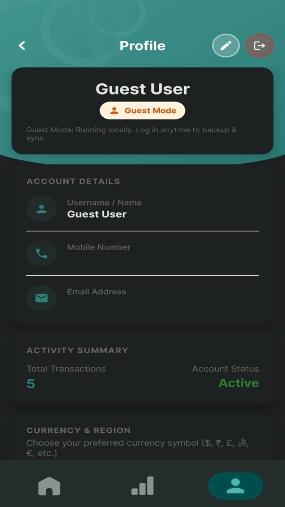
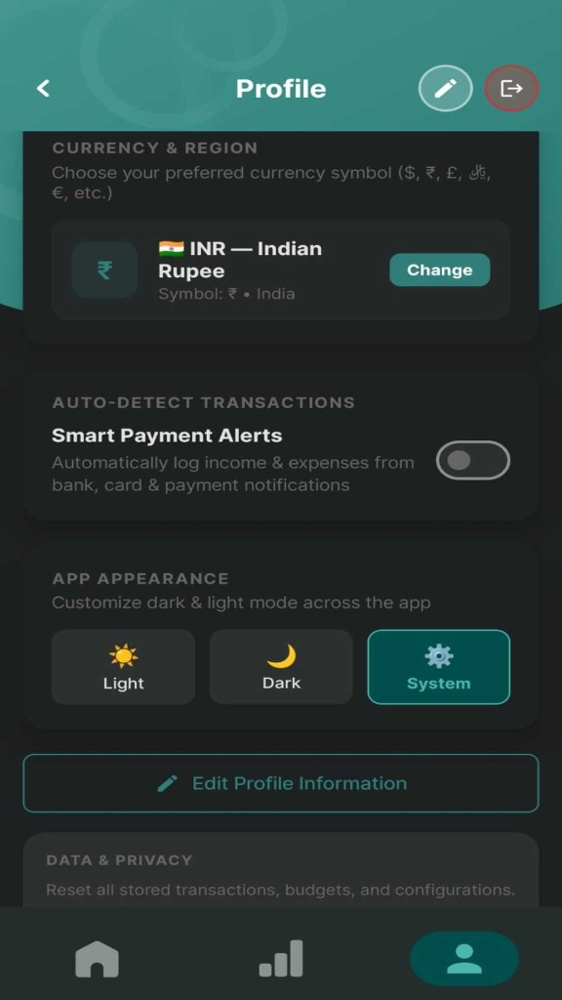

# 💰 Vaulta — Smart Personal Finance & Expense Tracker

<p align="center">
  
</p>

<p align="center">
  <strong>Take absolute control of your personal finances with elegance, precision, and privacy.</strong><br/>
  An intelligent, offline-first Android personal expense tracker and budget manager (<code>com.waleed.vaulta.android</code>) built natively with Jetpack Compose, Material 3, Room Database, and Supabase Cloud Auth.<br/>
</p>

<p align="center">
  <a href="https://kotlinlang.org/"></a>
  <a href="https://developer.android.com/jetpack/compose"></a>
  <a href="https://developer.android.com/training/data-storage/room"></a>
  <a href="https://supabase.com/"></a>
  <a href="https://developer.android.com/training/dependency-injection/hilt-android"></a>
  <a href="https://developer.android.com/about/versions/14"></a>
  <a href="LICENSE"></a>
</p>

---

## 📖 Table of Contents

- [About Vaulta](#-about-vaulta)
- [Key Features](#-key-features)
- [Visual App Showcase](#-visual-app-showcase)
- [Tech Stack & Architecture](#-tech-stack--architecture)
- [Project Directory Structure](#-project-directory-structure)
- [Getting Started & Installation](#-getting-started--installation)
- [Privacy Policy & Data Security](#-privacy-policy--data-security)
- [License & Author](#-license--author)

---

## 📱 About Vaulta

**Vaulta** (`com.waleed.vaulta.android`) is a modern, privacy-focused personal finance manager and expense tracker engineered from the ground up for the Android ecosystem. Combining **offline-first local persistence** with seamless **cloud synchronization**, Vaulta empowers you to monitor daily cash flow, establish monthly budgets, inspect visual spending trends, and export audit-ready reports without sacrificing personal privacy.

---

## ✨ Key Features 

### 1. 💸 Expense & Income Tracking + Split Bill, Universal Shared Ledger & Dedicated Credit/Owe (v1.5.2)
- **Fast Transaction Logging:** Dedicated, distraction-free entry layouts optimized separately for income streams, expenses, and Credit/Owe obligations.
- **Dedicated Credit & Owe Ledger (v1.5.2):** Credit and Owe obligations are stored in a dedicated `credit_owe` database table, completely separating them from personal expenses. Your daily spending, monthly budget calculations, and income charts remain 100% clean and unpolluted.
- **Split Bill (Splitwise-Style Group Splitter):** Dedicated Indigo FAB action allowing you to split group bills (e.g., dinners, shared trips, apartment rent) between multiple participants.
  - Supports **Equal Split** (automatic even distribution among all participants) and **Custom Split** (per-person custom amounts with live total validation).
  - Clean separation: Split bill shares are tracked exclusively within `shared_splits` without creating redundant fake personal expense records.
  - **Participant Management & Contact Picker (v1.5.2):** Enter participants manually or tap **Pick Contact** to select directly from your device address book with smooth runtime permissions.
- **Group & Individual Settle Up (v1.5.2):** In the Transaction List screen, group splits display a **Settle All** button for closing the entire bill in one click, alongside individual participant **Settle** actions. Bilateral Credit / Owe cards include one-tap settlement and edit/delete controls.
- **Live Vaulta Contact Lookup:** When adding participants in Split Bill or Credit & Owe, entering an email or mobile number triggers a debounced live search against registered Vaulta accounts. If a registered user is found, a verified match badge (`Vaulta user found: {Name} ✓`) is displayed, their name is auto-filled if blank, and the obligation is bound directly to their user ID.
- **Retroactive Profile Contact Linking:** Adding or updating your phone number or email address in your Profile immediately triggers background auto-linking for all past or pending splits and Credit/Owe obligations assigned to that contact identifier.
- **Universal Shared Credit/Owe Ledger:**
  - View cross-account shared splits and bilateral Credit/Owe obligations in the full Transaction List screen under the **Shared Splits** or **Credit / Owe** filter chips.
  - **Perspective-Aware Rendering:** Dynamically detects whether you created the split or are a participant (via contact matching), cleanly indicating who owes whom (e.g., *"Alex owes you"* vs *"You owe Sarah"*).
  - **Sync & Settlement Status Chips:** Displays real-time status chips for `"Synced"` (cloud-backed) / `"Local"` and `"Pending"` / `"Settled"`.
  - **Settle Up Action:** Mark obligations as settled with one tap, instantly updating locally and across Supabase cloud.
- **Credit & Owe FAB Action:** Expandable FAB features a vibrant Amber/Yellow action allowing you to log whether someone owes you money (Credit / Balance `+`) or you owe someone (Owe / Balance `-`) with optional contact picker and cross-device cloud sync.
- **Optional Transaction Notes:** Add optional descriptive notes to any transaction during creation, edit existing transactions with notes, and view notes in receipts and transaction histories.
- **Custom Notes & Titles:** Tap the ✏️ pencil tool to record custom merchant or project titles (e.g., *"Freelance Retainer"*, *"Farmers Market"*) while retaining primary category tags.
- **Rich Category Presets:**
  - *Income:* Salary, Freelance, Investments, Bonus, Rental Income, Gifts & Donations, Other.
  - *Expense:* Groceries, Utilities, Food & Dining, Rent, Healthcare, Transport, Shopping, Entertainment, Subscriptions, Education, Debt.
  - *Credit & Owe:* Owed to You, You Owe.
- **Calendar Date Picker:** Built-in Material 3 date dialog allows backdating and accurate transaction record-keeping.

### 2. 📊 Statistics Screen with 3 Dedicated Tabs & Dual Line Graph
- **Expenses Tab:** View interactive spending graph and "Top Spending" category breakdown.
- **Income Tab:** View earnings trend graph and matching "Top Earning" breakdown.
- **Credit / Owe Tab:** View dual dataset line chart featuring **You Owe** in Pink (`#EC4899`) and **Owed to You** in Purple (`#A855F7`) with legend and "Top Credit" breakdown.

### 2. 🔍 Advanced Filtering & Custom Date Ranges
- **Instant Keyword Search:** Real-time search bar that filters transactions by title, category, or numerical amount.
- **Type & Category Filters:** Quickly toggle between **All**, **Income**, and **Expense**, or filter by specific categories.
- **Preset & Custom Date Ranges:** Browse by *Today*, *This Week*, *This Month*, *Last Month*, or choose an exact custom start and end date using the Material 3 `DateRangePicker`.
- **Dynamic KPI Balance Strip:** Dynamically updates filtered Total Income, Total Expense, and Net Balance with a one-tap **Reset Filters** action.

### 3. 📄 PDF & PNG Statements & Receipt Sharing
- **Direct PDF & PNG Downloads:** Export full financial statements as audit-ready **PDF documents** or high-resolution **PNG images** directly into the device's public `Downloads/Vaulta/` directory using Android Scoped Storage (`MediaStore.Downloads`) without runtime storage permission prompts.
- **Single Receipt Export & Sharing:** Generate branded, itemized transaction receipt cards with official Vaulta headers, verification IDs, timestamps, and active currency symbols, exportable as **PDF** or **PNG**.
- **Multi-Format Share Sheet:** Share individual receipts or the complete filtered transaction statement directly via WhatsApp, Telegram, Gmail, or any installed messaging app.
- **Instant Open Action:** In-app download notifications include an **"OPEN"** / **"VIEW"** button to launch the saved PDF or PNG in your preferred viewer.

### 4. 📊 Visual Spending Analytics
- **Cubic-Bezier Velocity Curves:** Smooth, anti-aliased charts powered by MPAndroidChart with gradient fill effects.
- **Cash Flow Trajectory:** Toggle between income trajectories and spending velocity over custom timeframes.
- **Category Progress Bars:** Proportional horizontal progress bars illustrating the exact percentage split consumed by each category.
- **Monthly Budget Ceilings:** Set monthly spending targets with automatic alerts when approaching 80% or exceeding 100%.

### 5. 🔐 Flexible Authentication & Full Cloud Backup / Restore Across Reinstall (v1.5.0)
- **Multi-Method Sign-In:** Sign in using Google One-Tap / Android Credential Manager, Email & Password, Mobile Number & Password (without OTP), or Email / Phone OTP.
- **Editable International Calling Code:** Mobile login and registration feature a side-by-side editable country code input (defaulting to `+91`, supporting all global codes like `+1`, `+44`, `+971`) with E.164 normalization.
- **Set Current Balance & Persistent Balance Tracking (RoomDB + Cloud):** Set or calibrate your real-world starting or current balance via a subtle edit action on the Home Total Balance card without inflating monthly income or distorting spending analytics charts (`totalBalance = initialBalance + (totalIncome - totalExpense)`). Persisted locally in the `user_balance` RoomDB table and synchronized securely with Supabase `public.profiles` (`initial_balance` and live `current_balance`).
- **Group Bill Splitter (Equal & Custom) & Universal Shared Credit/Owe Ledger:** Group expense splitter supporting Equal and Custom split modes, optional creator expense inclusion, and bilateral credit/owe tracking synced across user accounts in the `shared_splits` RoomDB table and Supabase backend.
- **Reliable Cloud Sync for Manual & Background Auto-Detected Transactions:** Integrates cold-start Supabase session initialization (`awaitInitialization()` and automatic token refresh) and a network-constrained WorkManager one-time worker (`CloudSyncWorker`) with exponential backoff. Ensures that all manual, offline, and background auto-detected bank/UPI transactions synchronize reliably to Supabase as soon as network is connected.
- **Full Supabase Cloud Backup & Reinstall Restore:** Authenticated user profiles, transactions, Credit/Owe obligations, shared splits, balance figures (`initial_balance` & `current_balance`), optional notes, monthly budget limits, and currency preferences synchronize securely with PostgreSQL on Supabase protected by Row Level Security (`auth.uid() = user_id`). Uninstalling and reinstalling the app and logging back in immediately restores 100% of user profile details and all historical transactions directly into local RoomDB and preferences.
- **Persistent Profile Details Across Reinstalls:** Profile edits (such as custom display names and phone numbers) are preserved across logins and app reinstalls for Google, Email, and Mobile Number accounts without being overwritten by OAuth defaults, generic email prefixes, or `"EMPTY"` placeholders.
- **One-Time Privacy Policy Consent Gate Across All Entry Paths:** Full-screen Privacy Policy acceptance gate enforced consistently across Continue with Google, Email Sign-In / Sign-Up, Mobile Number Sign-In / Sign-Up (without OTP), and Guest Mode. Features simplified privacy wording clearly stating that user info is processed locally on-device and stored on a secure backend. Acceptance is saved locally and synchronized to Supabase `public.profiles` (`privacy_policy_accepted = true`), ensuring returning users who already accepted are never prompted again.
- **100% Offline Guest Mode:** Use all core features anonymously without creating an account or uploading data to the cloud; Guest Mode makes zero network calls and stores data strictly on-device.
- **Strict Multi-Account Isolation:** Database queries partition transactions strictly by user ID (`WHERE userId = :userId`), and switching accounts safely isolates transaction histories and settings without data leakage.

### 6. ⚡ Smart Auto-Detect Transactions (Privacy-First On-Device, SMS-Only)
- **Automatic Payment Logging from SMS:** Optional, strictly opt-in feature using Android's `NotificationListenerService` to automatically record income and expenses from official bank and payment SMS text messages.
- **Clean Native Material 3 Badge & Setup Info Tooltip:** Replaced heavy pill containers with a clean, native Material 3 status badge (`Active & Connected` / `Access Required`). Device setup instructions (including Xiaomi/HyperOS Autostart and Battery Saver guidance) are accessible via a subtle information tooltip dialog next to the section title.
- **Strict SMS-Only Allowlist:** Dynamically inspects the system default SMS app (`Telephony.Sms.getDefaultSmsPackage`) and recognized messaging apps (`com.google.android.apps.messaging`, `com.android.mms`, `com.samsung.android.messaging`, `com.miui.mms`, `com.microsoft.android.smsorganizer`, etc.). Explicitly blocks and ignores social and chat apps like WhatsApp, Telegram, Instagram, Discord, Slack, etc., ensuring casual chat conversations are never logged.
- **Financial Context Validation:** Employs strict structural validation requiring legitimate banking/transaction indicators (A/c, card ending, UPI, ref, balance, debited/credited) to guarantee casual texts mentioning currency or numbers are safely rejected.
- **Multi-Currency Parser:** Extracts amounts in global formats and currencies (`₹`, `Rs.`, `$`, `USD`, `€`, `EUR`, `£`, `GBP`, `AED`, `SAR`, etc.) including European comma formats (`€19,99`).
- **100% Local & Private:** Evaluated strictly on-device in memory. Raw notification text is **never saved, logged, or uploaded** to the cloud.
- **Noise & Scam Elimination:** Intelligently rejects OTPs, two-factor authentication codes, payment requests, mandates, promotional spam, and ending account balances (`Avl Bal`).
- **Intelligent Deduplication & Direction Protection:** 25-second rolling window prevents duplicate entries across simultaneous SMS alerts, and guarantees that incoming credit alerts (e.g. "X paid you", "sent you", "received from", "credited") are strictly classified as Income and never produce duplicate or contradictory Expense rows.
- **Title Normalization & Row Collision Prevention:** Extracted titles are cleaned of trailing transaction text (e.g. normalizing `"ABC Paid You 101.00"` to `"ABC"`), and transaction list rows use weighted layout boundaries with ellipsis truncation to ensure titles never overlap amounts.
- **Slimmer Navigation & Standardized Typography:** Refined bottom navigation bar to a sleek 62dp height with compact padding, and standardized typography across all screens (14sp–16sp standard body/labels) eliminating uncomfortably small text.

### 7. 🗑️ Safe Swipe-to-Delete (Hardened 55% Threshold) & Long-Press Action Menu (with Undo)
- **Hardened Swipe-to-Delete Threshold:** Configured with an intentional `0.55f` (55% width) positional threshold on `SwipeToDismissBox` to completely eliminate accidental deletions caused by casual scrolling or edge-to-edge system back gestures. Swipe background smoothly transitions opacity, providing clear visual confirmation before a dismiss is triggered.
- **Long-Press Transaction Action Menu:** Long-pressing any transaction card in either the Home feed or the full Transaction History triggers pleasant haptic feedback (`HapticFeedbackType.LongPress`) and opens a clean Material 3 modal bottom sheet with one-tap actions:
  - **Edit Transaction:** Directly opens the transaction receipt editor.
  - **Delete Transaction:** Safely deletes the transaction and launches the exact same instantaneous **Undo Snackbar** flow.
  - **Cancel:** Dismisses the menu.
- **Item Detail Removal:** Direct **Delete Transaction** action button inside the itemized receipt view with safety confirmation.
- **Instant Undo:** Vaulta-branded snackbar with a 4.5-second **UNDO** button to instantly restore accidentally deleted entries across local RoomDB and Supabase cloud.
- **In-App "Reset Everything":** Double-confirmed safety reset option in the Profile screen under *Data & Privacy* to permanently wipe local transactions, reset budgets to zero, and clear auto-detect preferences for the active user account.

### 8. ✏️ Full Transaction Editing
- **In-Place Modification:** Update any transaction title/merchant, amount, type (Income or Expense), category, and date directly from the itemized receipt view.
- **Reactive State Sync:** Instantly recalculates cash flow velocity curves, monthly spends, category breakdowns, and net balances across RoomDB and Supabase.

---

## 📸 Visual App Showcase

| 🌟 Brand Splash Screen | 🔐 Secure Sign In | 📝 Registration (Email & Mobile) |
| :---: | :---: | :---: |
|  |  |  |
| *Emerald branding splash with animated logo & security badge.* | *Sign in via Email, Mobile, Google One-Tap, or Guest Mode.* | *Tabbed registration with editable international country codes.* |

| 🏠 Home Dashboard | 🟢 Add Income Flow | 🔴 Add Expense Flow |
| :---: | :---: | :---: |
|  |  |  |
| *Net balance card, monthly cash flow, spend monitor, and recent entries.* | *Dedicated Income entry with custom title pencil button and date picker.* | *Quick Expense logger with formatted numerical input and calendar dialog.* |

| 📊 Spends Dashboard & Budget | 📉 Expense Statistics Curve | 📈 Income Analytics Curve |
| :---: | :---: | :---: |
|  |  |  |
| *Category progress bar, spend splits, and monthly budget limits.* | *Cubic-bezier expense velocity chart with ranked top expenses.* | *Earnings graph displaying revenue trajectories across custom dates.* |

| 👤 Guest & Account Details | ⚙️ Currency, Auto-Detect & Settings |
| :---: | :---: |
|  |  |
| *Account profile with active guest/cloud status, transactions count, and user details.* | *INR/global currency switcher, Auto-Detect notification toggle, and Material 3 theme modes.* |

---

## 🏗️ Tech Stack & Architecture

Vaulta adheres to Google's official Android Architecture Guidelines, implementing **MVVM (Model-View-ViewModel)** with **Clean Architecture principles**, **Unidirectional Data Flow (UDF)**, and **Modular Dependency Injection**:

```
┌────────────────────────────────────────────────────────┐
│                   UI Layer (View)                      │
│        Jetpack Compose (Material 3 Components)         │
│ HomeScreen | AddExpense | SpendsDashboard | StatsScreen│
│ TransactionListScreen | VaultaSnackbarHost             │
└──────────────────────────▲─────────────────────────────┘
                           │ Observes State (StateFlow)
                           │ Emits UI Events
┌──────────────────────────┴─────────────────────────────┐
│                   ViewModel Layer                      │
│   HomeViewModel | BudgetViewModel | ProfileViewModel   │
│   TransactionListViewModel | AuthViewModel             │
└──────────────────────────▲─────────────────────────────┘
                           │ Reactive Streams (Flow)
                           │ Coroutines Dispatchers
┌──────────────────────────┴─────────────────────────────┐
│                  Repository Layer                      │
│        ExpenseRepository | SupabaseAuthRepository      │
│        BudgetRepository  | UserSessionManager          │
└──────────────────────────▲─────────────────────────────┘
              ┌────────────┴────────────┐
              ▼                         ▼
┌──────────────────────────┐  ┌──────────────────────────┐
│      Local Storage       │  │      Cloud Backend       │
│      Room Database       │  │      Supabase 3.0        │
│   (User-Scoped SQLite)   │  │   (Auth + RLS Database)  │
└──────────────────────────┘  └──────────────────────────┘
```

### 🛠️ Technology Breakdown

| Component | Technology | Version | Purpose |
|---|---|---|---|
| **Language** | [Kotlin](https://kotlinlang.org/) | `1.9.24` | Modern, safe programming language for native Android |
| **UI Toolkit** | [Jetpack Compose BOM](https://developer.android.com/jetpack/compose) | `2024.06.00` | Modern declarative reactive UI toolkit |
| **Design System** | [Material 3](https://m3.material.io/) | Latest | Google's Material Design 3 UI components |
| **Local Persistence** | [Room Database](https://developer.android.com/training/data-storage/room) | `2.6.1` (DB v7) | User-partitioned SQLite cache (`expense_table`, `shared_splits`, `user_balance`) with Coroutines Flow |
| **Cloud Backend** | [Supabase BOM](https://supabase.com/) | `3.0.0` | Cloud authentication & PostgreSQL sync with RLS |
| **Email Service** | Brevo API | Cloud | Transactional OTP and password reset emails |
| **Dependency Injection** | [Dagger Hilt](https://dagger.dev/hilt/) | `2.51` | Standardized modular dependency injection |
| **Google Sign-In** | [AndroidX Credentials](https://developer.android.com/training/sign-in/credential-manager) | `1.3.0` | Modern Credential Manager with Google ID |
| **Document Export** | Android Native `PdfDocument` | Native | Vector A4 receipt & financial statement generation |
| **File Storage** | `MediaStore.Downloads` | Native | Scoped storage direct saving to `Downloads/Vaulta/` |
| **Charts & Graphs** | [MPAndroidChart](https://github.com/PhilJay/MPAndroidChart) | `v3.1.0` | Cubic bezier line curves and visual analytics |

---

## 📂 Project Directory Structure

```text
Vaulta/
├── app/
│   ├── src/
│   │   ├── main/
│   │   │   ├── java/com/waleed/vaulta/android/
│   │   │   │   ├── base/                    # Base ViewModels & UI Navigation events
│   │   │   │   ├── data/                    # Data layer: database, DAOs, and repositories
│   │   │   │   │   ├── auth/                # Supabase auth, OTP, and phone normalization
│   │   │   │   │   ├── budget/              # BudgetManager & notification helpers
│   │   │   │   │   ├── dao/                 # ExpenseDao with user-partitioned queries
│   │   │   │   │   ├── model/               # ExpenseEntity, CurrencyItem, UserProfile
│   │   │   │   │   ├── repository/          # ExpenseRepository, AuthRepository, BudgetRepository
│   │   │   │   │   ├── session/             # UserSessionManager & account registry
│   │   │   │   │   ├── CurrencyManager.kt   # Global multi-currency state manager
│   │   │   │   │   └── ExpenseDatabase.kt   # Room Database (v3) & schema migrations
│   │   │   │   ├── di/                      # Dagger Hilt DatabaseModule & RepositoryModule
│   │   │   │   ├── feature/                 # UI Feature Composables & ViewModels
│   │   │   │   │   ├── add_expense/         # Dedicated Add Expense & Income screens
│   │   │   │   │   ├── auth/                # LoginScreen, RegisterScreen, PasswordResetDialog
│   │   │   │   │   ├── budget/              # SpendsDashboardScreen & category bars
│   │   │   │   │   ├── home/                # HomeScreen, balance cards, recent transactions
│   │   │   │   │   ├── profile/             # ProfileScreen, currency dialog, theme toggle
│   │   │   │   │   ├── splash/              # Animated brand SplashScreen
│   │   │   │   │   ├── stats/               # MPAndroidChart bezier curve analytics
│   │   │   │   │   └── transactionlist/     # Full searchable ledger, filters & export dialog
│   │   │   │   ├── ui/theme/                # Colors, Typography, Shapes, Material 3 Theme
│   │   │   │   ├── utils/                   # ReceiptExportManager (PDF/PNG), VaultaToast
│   │   │   │   ├── widget/                  # VaultaSnackbarHost & custom UI components
│   │   │   │   ├── MainActivity.kt          # Single-Activity entry point
│   │   │   │   ├── NavHostScreen.kt         # Navigation graph & animated bottom app bar
│   │   │   │   └── Vaulta.kt                # Application class (@HiltAndroidApp)
│   │   │   └── res/                         # Vector drawables, mipmaps, string resources
│   │   └── test/                            # Unit and instrumentation tests
│   ├── build.gradle.kts                     # App module build configuration (v1.4.9 - Build 17)
│   └── proguard-rules.pro                   # ProGuard / R8 rules
├── screenshots/                             # High-resolution application screenshots
├── PRIVACY_POLICY.md                        # Official Privacy Policy
├── supabase_schema.sql                      # Supabase PostgreSQL database schema & triggers
└── README.md                                # Project documentation
```

---

## 🚀 Getting Started & Installation

### Prerequisites

- **Android Studio:** Android Studio Iguana / Jellyfish (2023.2.1+) or newer.
- **JDK:** Java 17 or higher.
- **Android SDK:** API Level 34 / 36 (Android 14+).
- **Minimum OS Supported:** Android 7.0 (API Level 24).

### Step-by-Step Setup

1. **Clone the repository:**
   ```bash
   git clone https://github.com/WinBlader/Vaulta-Smart-Expense-Tracker.git
   cd Vaulta-Smart-Expense-Tracker
   ```

2. **Configure Local Properties:**
   Copy `local.properties.example` to `local.properties`:
   ```bash
   cp local.properties.example local.properties
   ```
   Add your Android SDK path and optional Supabase / Google Client credentials:
   ```properties
   sdk.dir=/path/to/your/android/sdk
   SUPABASE_URL=https://your-project-ref.supabase.co
   SUPABASE_ANON_KEY=your-supabase-anon-key
   GOOGLE_WEB_CLIENT_ID=your-google-web-client-id.apps.googleusercontent.com
   ```
   *(Note: If credentials are left blank, Vaulta runs seamlessly in offline Guest Mode with all local features fully enabled).*

3. **Build the Debug APK:**
   ```bash
   ./gradlew assembleDebug
   ```

4. **Deploy to Device or Emulator:**
   - Connect an Android device with USB Debugging enabled, or launch an AVD.
   - Click **Run ▶** in Android Studio.

---

## 🔒 Privacy Policy & Data Security

Vaulta is committed to complete user privacy:
- **Mandatory Privacy Policy Acceptance Gate:** A dedicated, full-screen Privacy Policy gate renders immediately upon new user registration, first-time Guest Mode entry, and for upgraded existing accounts before granting access to the dashboard. Acceptance (`privacy_policy_accepted_v1`) is persisted locally and securely synchronized to the user's Supabase cloud profile.
- **Offline-First by Design:** All financial transactions remain stored locally on your device by default.
- **Zero Data Monetization:** Vaulta never sells, rents, or shares personal or financial data with third-party advertisers.
- **Strict Multi-User Isolation:** Each account's data is strictly partitioned by user ID in the local database. Transactions, balances, and statistics are safely preserved across sessions and synchronized with Supabase cloud on sign-in.
- **Account Reset & Deletion:** Users can purge their local data anytime via **Reset Everything** in Profile Settings, or request complete account and cloud data deletion.

For complete details, please read our official [**PRIVACY_POLICY.md**](PRIVACY_POLICY.md).

---

## 📜 License & Author

Distributed under the **MIT License**. See [`LICENSE`](LICENSE) for complete details.

### Author & Contact
**winblader.org**
- **GitHub:** [@WinBlader](https://github.com/WinBlader)
- **Email:** `winblader.org@gmail.com`
- **Repository:** [WinBlader/Vaulta-Smart-Expense-Tracker](https://github.com/WinBlader/Vaulta-Smart-Expense-Tracker)

<p align="center">
  If you find Vaulta helpful, please consider starring ⭐️ this repository!
</p>
