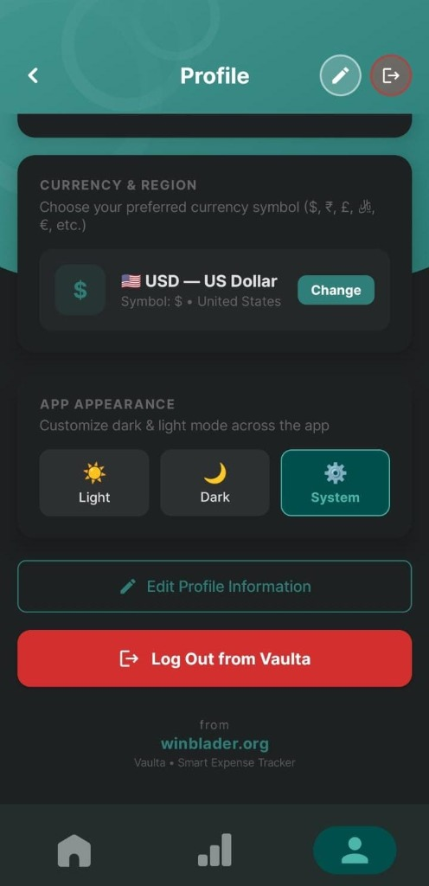

# 💰 Vaulta — Smart Expense Tracker & Personal Finance Manager

<p align="center">
  
</p>

<p align="center">
  <strong>Take absolute control of your personal finances with elegance, precision, and privacy.</strong><br/>
  An intelligent, modern Android personal finance and income-expense tracker built natively with Jetpack Compose, Material 3, Room Database, and Supabase Cloud Auth.
</p>

<p align="center">
  <a href="https://kotlinlang.org/"></a>
  <a href="https://developer.android.com/jetpack/compose"></a>
  <a href="https://supabase.com/"></a>
  <a href="https://developer.android.com/training/dependency-injection/hilt-android"></a>
  <a href="https://developer.android.com/training/data-storage/room"></a>
  <a href="https://developer.android.com/about/versions/14"></a>
  <a href="LICENSE"></a>
</p>

---

## 📖 Table of Contents

- [About Vaulta](#-about-vaulta)
- [Visual App Showcase & Screen Walkthrough](#-visual-app-showcase--screen-walkthrough)
- [Core Features](#-core-features)
  - [1. International Authentication & Anonymous Guest Mode](#1--international-authentication--anonymous-guest-mode)
  - [2. Multi-Account Privacy & User-Partitioned Local Storage](#2--multi-account-privacy--user-partitioned-local-storage)
  - [3. Intelligent Real-Time Dashboard & Cashflow Engine](#3--intelligent-real-time-dashboard--cashflow-engine)
  - [4. Precision Transaction Logging & Custom Titles](#4--precision-transaction-logging--custom-titles)
  - [5. Advanced Search, Filtering & Custom Date Ranges](#5--advanced-search-filtering--custom-date-ranges)
  - [6. Direct PDF Download & Branded Receipt Sharing](#6--direct-pdf-download--branded-receipt-sharing)
  - [7. Spends Dashboard & Proactive Budget Ceilings](#7--spends-dashboard--proactive-budget-ceilings)
  - [8. Visual Financial Analytics & Gradient Curves](#8--visual-financial-analytics--gradient-curves)
  - [9. Custom Vaulta-Branded Floating Snackbars](#9--custom-vaulta-branded-floating-snackbars)
  - [10. Global Multi-Currency Localization & High-Contrast Themes](#10--global-multi-currency-localization--high-contrast-themes)
- [Architecture & Tech Stack](#-architecture--tech-stack)
- [Supabase Cloud Backend & Database Schema](#-supabase-cloud-backend--database-schema)
- [Project Directory Structure](#-project-directory-structure)
- [Getting Started & Installation](#-getting-started--installation)
- [Contributing](#-contributing)
- [License & Author](#-license--author)

---

## 📱 About Vaulta

**Vaulta** is an all-in-one personal finance manager and smart expense tracker engineered natively for the modern Android ecosystem. Designed to turn personal bookkeeping into an effortless daily habit, Vaulta combines an ultra-fast, **offline-first local database** with optional **cloud authentication & profile synchronization**, giving you complete financial clarity without sacrificing privacy, speed, or aesthetics.

Whether tracking daily grocery bills, managing freelance income, enforcing strict monthly spending limits, analyzing financial velocity through smooth cubic-bezier charts, or downloading audit-ready PDF receipts directly to your device, Vaulta delivers a fluid, responsive, and privacy-conscious experience.

### Why Choose Vaulta?
- **Speed & Fluidity**: Built 100% with declarative Jetpack Compose and Material 3 with zero XML overhead.
- **Privacy First**: Fully functional offline Guest Mode allows complete financial management without ever signing up or uploading data.
- **Strict Data Isolation**: Multi-account database architecture ensures transactions and monthly budgets are partitioned per user with zero cross-account data leaks.
- **Audit-Ready Exports**: Generate and download itemized PDF receipts and statement reports directly to public storage with a single tap.
- **Global Reach**: Comprehensive multi-currency support (₹, $, €, £, ﷼, AED, ¥, KD, CHF, etc.) with reactive app-wide updates.

---

## 📸 Visual App Showcase & Screen Walkthrough

Explore the visual design, typography, and functional layout of Vaulta:

### 1. Onboarding & Authentication
| 🌟 Brand Splash Screen | 🔐 Supabase Sign In | 📝 Registration (Email & Mobile) |
| :---: | :---: | :---: |
|  |  |  |
| *Emerald branding splash with animated logo & security badge.* | *Sign in via Email or Mobile, Google One-Tap, or instantaneous Guest Mode.* | *Tabbed Email & Mobile registration with editable country code & Supabase Auth.* |

---

### 2. Transaction Management & Cash Flow
| 🏠 Home Dashboard | 🟢 Add Income Flow | 🔴 Add Expense Flow |
| :---: | :---: | :---: |
|  |  |  |
| *Net balance card, monthly cashflow cards, spend monitor, recent transactions, and multi-action FAB.* | *Dedicated Income entry with custom title pencil button, category dropdown, and date picker.* | *Quick Expense logger with formatted numerical input, category tags, and calendar dialog.* |

---

### 3. Financial Analytics & Budget Tracking
| 📊 Spends Dashboard & Budget | 📉 Expense Statistics Curve | 📈 Income Analytics Curve |
| :---: | :---: | :---: |
|  |  |  |
| *Proportional category progress bar, percentage spend splits, and monthly budget limits.* | *Cubic-bezier expense velocity chart with gradient fill and ranked top expense breakdown.* | *Earnings graph displaying revenue trajectories across custom dates and transactions.* |

---

### 4. Customization, Themes & Profile
| 💱 Currency & Theme Settings | 👤 User Account Details | 📑 Category Allocation View |
| :---: | :---: | :---: |
|  |  |  |
| *Global currency selector with live app-wide update; Light, Dark, and System Theme toggles.* | *Profile card with Supabase auth status, verified email/mobile details, and live transaction counter.* | *Month-by-month category spend distribution and budget tracking insights.* |

> [!TIP]
> All screenshots are available in high resolution inside the [`screenshots/`](screenshots/) directory.

---

## ✨ Core Features

### 1. 🔐 International Authentication & Anonymous Guest Mode
- **Editable Country Calling Code**: Side-by-side editable `OutlinedTextField` supporting all international calling codes (`+1`, `+44`, `+91`, `+971`, etc.) with full E.164 phone normalization.
- **Supabase Cloud Authentication**: Secure cloud sign-in and registration supporting both email and mobile credentials with PostgreSQL Row Level Security (RLS).
- **Google One-Tap Access**: Native Credential Manager integration for frictionless 1-tap Google sign-in.
- **100% Offline Guest Access**: Skip account creation entirely with **"Continue as Guest"** to maintain complete privacy and store all data locally.
- **Helpful Password Reset**: Clear instructions and spam folder hints to ensure seamless password recovery.

### 2. 🛡️ Multi-Account Privacy & User-Partitioned Local Storage
- **Per-User Database Partitioning**: Room Database queries filter strictly by `WHERE userId = :currentUserId` so multiple accounts on the same device can never see each other's records.
- **Automated Sign-Out Purge**: Signing out or switching accounts immediately wipes local cached records and resets active budget monitors before returning to the sign-in screen.
- **Zero Cross-Account Data Leaks**: Guest records, personal accounts, and business logins maintain independent financial ledgers and monthly ceilings.

### 3. 🏠 Intelligent Real-Time Dashboard & Cashflow Engine
- **Live Net Balance Engine**: Dynamically computes aggregate liquidity in real time as earnings and expenses are logged.
- **Monthly Cashflow Overview**: Color-coded Income (green) and Expense (red) metric cards provide an immediate snapshot of current financial health.
- **Monthly Spends Monitor**: Highlights total expenditures for the current billing cycle with direct shortcuts to adjust monthly budget targets.
- **Recent Activity Ledger**: Displays verified merchant icons (Salary, Groceries, Utilities, Subscriptions, Rent, etc.) with debit/credit badges.
- **Spring-Animated FAB**: Multi-action floating button with physics-based spring animations for quick access to *Add Income* and *Add Expense*.

### 4. 💸 Precision Transaction Logging & Custom Titles
- **Dual-Flow Interfaces**: Dedicated layouts optimized specifically for income streams and expense categories.
- **Custom Title Override**: Tap the ✏️ **"Write Custom Title"** button to enter specific merchant descriptions (e.g., *"Freelance App Retainer"*, *"Farmers Market Vegetables"*) while preserving standard category grouping.
- **Rich Category Presets**:
  - *Income*: Salary, Freelance, Investments, Bonus, Rental Income, Gifts & Donations, Other.
  - *Expense*: Groceries, Utilities, Food & Dining, Rent, Healthcare, Transport, Shopping, Entertainment, Subscriptions, Education, Debt.
- **Calendar Date Picker**: Built-in Material 3 date dialog allows historical backdating and accurate records management.

### 5. 🔍 Advanced Search, Filtering & Custom Date Ranges
- **Instant Reactive Search**: Real-time search bar instantly matches keywords across transaction notes, categories, and numerical amounts.
- **Type & Category Filter Chips**: Filter by **All**, **Income**, or **Expense**, or isolate specific categories.
- **Custom Date Range Picker**: Material 3 date picker lets you evaluate spending over custom intervals (e.g., specific tax years, travel vacations) alongside presets (*Today*, *This Week*, *This Month*, *Last Month*).
- **Live Summary KPI Strip**: Computes total filtered Income, Expense, and Net Balance on the fly, with a one-tap **Reset Filters** button.

### 6. 📄 Direct PDF Download & Branded Receipt Sharing
- **Direct Save to Downloads**: Save high-resolution PDF receipts and multi-transaction statements directly to `Downloads/Vaulta/` via Scoped Storage without runtime permission prompts on Android 10+.
- **Branded Receipt Documents**: Renders clean, itemized A4 PDFs and PNG image cards with Vaulta headers, reference IDs, completion badges, and user currency symbols.
- **Share Sheet Integration**: Easily share receipts with employers, accountants, or family members via email or messaging apps.
- **Instant Open Action**: Download confirmations include an **"OPEN"** button to launch your device's preferred PDF viewer directly.

### 7. 🎯 Spends Dashboard & Proactive Budget Ceilings
- **Proportional Category Progress Bar**: Segmented horizontal progress visualizer showing exact percentage allocations per category.
- **Ranked Percentage Breakdown**: Itemized ranking of categories by total expenditure and proportion.
- **Monthly Spending Limits**: Set a monetary spending ceiling with automatic high-priority notifications when reaching 80% (warning) or 100% (exceeded).
- **Historical Month Browser**: Navigate past months to review budgeting performance and seasonal trends.

### 8. 📈 Visual Financial Analytics & Gradient Curves
- **MPAndroidChart Cubic-Bezier Curves**: Smooth anti-aliased velocity charts with rich gradient fill effects.
- **Income Trajectory vs. Expense Velocity**: Switch effortlessly between earnings trajectories and spending curves.
- **Top Spending Highlights**: Automatically identifies top high-ticket transactions to assist in eliminating spending leaks.

### 9. 🔔 Custom Vaulta-Branded Floating Snackbars
- **No Generic Android Robot Icons**: Replaced standard Android 12+ toasts with custom Compose-animated floating pills.
- **Dark-Teal Aesthetic**: Notifications emerge smoothly with Vaulta's official app launcher icon, concise messaging, and interactive action buttons.

### 10. 💱 Global Multi-Currency Localization & High-Contrast Themes
- **Worldwide Currency Support**: Choose any world currency:
  - **Dollar (`$`)** — United States, Canada, Australia, Singapore
  - **Rupee (`₹`, `₨`)** — India, Pakistan, Sri Lanka, Nepal
  - **Pound (`£`)** — United Kingdom
  - **Euro (`€`)** — European Union
  - **Riyal / Dirham (`﷼`, `AED`, `SAR`)** — UAE, Saudi Arabia, Qatar
  - **Dinar (`KD`, `BD`, `JD`)** — Kuwait, Bahrain, Jordan
  - **Yen / Yuan (`¥`)** — Japan, China
  - **Franc (`CHF`)**, and dozens more with reactive app-wide updates.
- **OLED Dark & Light Themes**: High-contrast dark surfaces (`#121212`) paired with rich Emerald Green accents (`#004D40`, `#00796B`) for battery efficiency and visual comfort.

---

## 🏗️ Architecture & Tech Stack

Vaulta follows Google's recommended Android App Architecture guidelines implementing MVVM (Model-View-ViewModel) paired with Unidirectional Data Flow (UDF) and Dependency Injection:

```
┌────────────────────────────────────────────────────────┐
│                   UI Layer (View)                      │
│        Jetpack Compose (Material 3 Components)         │
│ HomeScreen | AddExpense | SpendsDashboard | StatsScreen│
│ TransactionListScreen | VaultaSnackbarHost             │
└──────────────────────────▲─────────────────────────────┘
                           │ Observes State (StateFlow)
                           │ Emits UI Events
┌──────────────────────────┴─────────────────────────────┐
│                   ViewModel Layer                      │
│   HomeViewModel | BudgetViewModel | ProfileViewModel   │
│   TransactionListViewModel | AuthViewModel             │
└──────────────────────────▲─────────────────────────────┘
                           │ Reactive Streams (Flow)
                           │ Coroutines Dispatchers
┌──────────────────────────┴─────────────────────────────┐
│                  Repository Layer                      │
│        ExpenseRepository | SupabaseAuthRepository      │
│        BudgetRepository  | UserSessionManager          │
└──────────────────────────▲─────────────────────────────┘
              ┌────────────┴────────────┐
              ▼                         ▼
┌──────────────────────────┐  ┌──────────────────────────┐
│      Local Storage       │  │      Cloud Backend       │
│      Room Database       │  │      Supabase 3.0        │
│   (User-Scoped SQLite)   │  │   (Auth + RLS Database)  │
└──────────────────────────┘  └──────────────────────────┘
```

### 🛠️ Technology Breakdown

| Layer | Component | Version | Description |
|---|---|---|---|
| **Language** | [Kotlin](https://kotlinlang.org/) | `1.9.24` | Modern, safe, and expressive language for native Android |
| **UI Toolkit** | [Jetpack Compose BOM](https://developer.android.com/jetpack/compose) | `2024.06.00` | Declarative reactive UI toolkit |
| **Design System** | [Material 3](https://m3.material.io/) | Latest | Google's Material Design specifications |
| **Backend & Auth** | [Supabase BOM](https://supabase.com/) | `3.0.0` | `auth-kt`, `postgrest-kt` for cloud authentication |
| **Google Sign-In** | [AndroidX Credentials](https://developer.android.com/training/sign-in/credential-manager) | `1.3.0` | Credential Manager with Google ID (`1.1.1`) |
| **HTTP Engine** | [Ktor Client OkHttp](https://ktor.io/) | `3.0.0` | High-performance asynchronous HTTP networking engine |
| **Dependency Injection** | [Dagger Hilt](https://dagger.dev/hilt/) | `2.51` | Standardized modular dependency injection |
| **Local Persistence** | [Room Database](https://developer.android.com/training/data-storage/room) | `2.6.1` | User-partitioned SQLite abstraction layer with Coroutines Flow |
| **PDF Generation** | Android `PdfDocument` | Native | Vector A4 receipt & financial statement generator |
| **File Storage** | `MediaStore.Downloads` | Native | Direct download to `Downloads/Vaulta/` via Scoped Storage |
| **Charts & Graphs** | [MPAndroidChart](https://github.com/PhilJay/MPAndroidChart) | `v3.1.0` | Cubic bezier line graphs and financial visualizer |

---

## ☁️ Supabase Cloud Backend & Database Schema

Vaulta includes a complete PostgreSQL migration script ([`supabase_schema.sql`](supabase_schema.sql)) for Supabase:

- **Row Level Security (RLS)**: Enforces strict data isolation so users only access and modify their own records.
- **PostgreSQL Automation Trigger (`handle_new_user`)**: Listens to Supabase `auth.users` creation events and automatically populates `public.profiles` with usernames, emails, and phone numbers.

---

## 📂 Project Directory Structure

```text
Vaulta/
├── app/
│   ├── src/
│   │   ├── main/
│   │   │   ├── java/com/waleed/vaulta/android/
│   │   │   │   ├── base/                    # Base ViewModels & UI Navigation events
│   │   │   │   ├── data/                    # Data sources, database, and repositories
│   │   │   │   │   ├── auth/                # Supabase auth client & phone normalization
│   │   │   │   │   ├── budget/              # Budget preferences & notification helpers
│   │   │   │   │   ├── dao/                 # ExpenseDao with user-partitioned Flow queries
│   │   │   │   │   ├── model/               # ExpenseEntity (userId scoped), Currency, UserProfile
│   │   │   │   │   ├── repository/          # ExpenseRepository, AuthRepository, BudgetRepository
│   │   │   │   │   ├── session/             # UserSessionManager & account registry
│   │   │   │   │   ├── CurrencyManager.kt   # Global currency reactive state holder
│   │   │   │   │   └── ExpenseDatabase.kt   # Room Database class & migrations
│   │   │   │   ├── di/                      # Dagger Hilt DatabaseModule & RepositoryModule
│   │   │   │   ├── feature/                 # Feature-driven Compose screens
│   │   │   │   │   ├── add_expense/         # Add Expense & Income with custom title
│   │   │   │   │   ├── auth/                # LoginScreen, RegisterScreen, PasswordResetDialog
│   │   │   │   │   ├── budget/              # SpendsDashboardScreen & category bars
│   │   │   │   │   ├── home/                # HomeScreen, balance cards, recent feed
│   │   │   │   │   ├── profile/             # ProfileScreen, currency dialog, theme toggle
│   │   │   │   │   ├── splash/              # Animated brand SplashScreen
│   │   │   │   │   ├── stats/               # MPAndroidChart bezier curve analytics
│   │   │   │   │   └── transactionlist/     # Searchable ledger, filters & receipt dialogs
│   │   │   │   ├── ui/theme/                # Colors, Typography, Shapes, Material 3 Theme
│   │   │   │   ├── utils/                   # ReceiptExportManager (PDF/PNG), VaultaToast
│   │   │   │   ├── widget/                  # VaultaSnackbarHost & custom UI widgets
│   │   │   │   ├── MainActivity.kt          # Single-Activity entry point
│   │   │   │   ├── NavHostScreen.kt         # Navigation graph & animated bottom app bar
│   │   │   │   └── Vaulta.kt                # Application class (@HiltAndroidApp)
│   │   │   └── res/                         # Vector drawables, mipmaps, string resources
│   │   └── test/                            # Unit and instrumentation tests
│   ├── build.gradle.kts                     # App module build script
│   └── proguard-rules.pro                   # ProGuard / R8 rules
├── screenshots/                             # 12 high-resolution application screenshots
├── PRIVACY_POLICY.md                        # Official Privacy Policy document
├── supabase_schema.sql                      # Supabase PostgreSQL database schema & triggers
└── README.md                                # Project documentation
```

---

## 🚀 Getting Started & Installation

### Prerequisites

- **Android Studio**: Android Studio Jellyfish / Iguana (2023.2.1+) or newer.
- **JDK**: Java 17 or higher.
- **Android SDK**: API Level 34 / 36 (Android 14+).
- **Minimum OS Supported**: Android 7.0 (API Level 24).

### Step-by-Step Setup

1. **Clone the repository:**
   ```bash
   git clone https://github.com/WinBlader/Vaulta-Smart-Expense-Tracker.git
   cd Vaulta-Smart-Expense-Tracker
   ```

2. **Configure Local Properties:**
   Copy `local.properties.example` to `local.properties`:
   ```bash
   cp local.properties.example local.properties
   ```
   Add your Android SDK path and optional Supabase / Google Client IDs:
   ```properties
   sdk.dir=/path/to/your/android/sdk
   SUPABASE_URL=https://your-project-ref.supabase.co
   SUPABASE_ANON_KEY=your-supabase-anon-key
   GOOGLE_WEB_CLIENT_ID=your-google-web-client-id.apps.googleusercontent.com
   ```
   *(Note: If left blank or default, Vaulta runs in offline Guest Mode with all features enabled).*

3. **Build the Debug APK:**
   ```bash
   ./gradlew assembleDebug
   ```

4. **Deploy to Device or Emulator:**
   - Connect an Android device with USB Debugging enabled, or launch an AVD.
   - Click the green **Run ▶** button in Android Studio.

---

## 🤝 Contributing

Contributions make the open-source community thrive! Any contributions you make are greatly appreciated:

1. **Fork** the Project.
2. **Create your Feature Branch**:
   ```bash
   git checkout -b feature/NewFeature
   ```
3. **Commit your Changes**:
   ```bash
   git commit -m "feat: Add NewFeature"
   ```
4. **Push to the Branch**:
   ```bash
   git push origin feature/NewFeature
   ```
5. **Open a Pull Request**.

---

## 📜 License

Distributed under the **MIT License**. See [`LICENSE`](LICENSE) for complete details.

---

## 👨‍💻 Author & Contact

**Waleed Wani**
- **GitHub**: [@WinBlader](https://github.com/WinBlader)
- **Repository**: [WinBlader/Vaulta-Smart-Expense-Tracker](https://github.com/WinBlader/Vaulta-Smart-Expense-Tracker)
- **Email**: `waleedwani06072005@gmail.com`
- **Website**: [winblader.org](https://winblader.org)

<p align="center">
  If you find Vaulta useful or inspiring, please give this repository a ⭐️!
</p>
